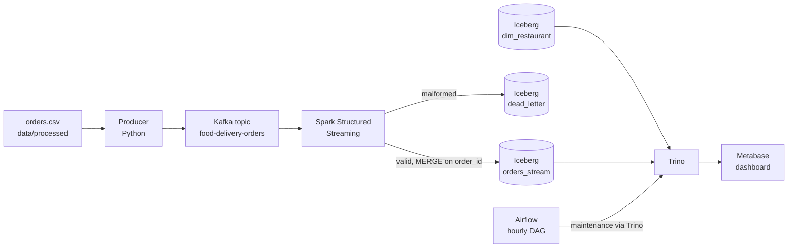

# Food Delivery Analytics Lakehouse Platform


An end-to-end data engineering project that ingests, cleans, models, and visualizes food delivery operational data, built in two phases:

- **Phase I:** a medallion (Bronze-Silver-Gold) lakehouse on **Databricks** with a self-triggering ETL pipeline and an interactive AI/BI dashboard.
- **Phase II:** a real-time lakehouse running in **Docker**, using Kafka, Spark Structured Streaming, Apache Iceberg, Trino, Metabase and Airflow.

Built as part of a Data Engineering coursework project, and designed to reflect real production practices (idempotency, atomicity, incremental loading, schema enforcement, automated orchestration) rather than a one-off analysis script.

> **Phase II demo video:** `<add your unlisted video link here>`

---

## Table of Contents

- [Overview](#overview)
- [Repository Structure](#repository-structure)
- [Data Sources](#data-sources)
- [Phase I: Databricks Lakehouse](#phase-i-databricks-lakehouse)
  - [Architecture](#architecture)
  - [Pipeline Details](#pipeline-details)
  - [Star Schema](#star-schema)
  - [Dashboard](#dashboard)
  - [Automation](#automation)
- [Local Python Pipeline](#local-python-pipeline)
- [Phase II: Real-Time Lakehouse](#phase-ii-real-time-lakehouse)
  - [Architecture](#phase-ii-architecture)
  - [What It Adds](#what-it-adds)
  - [Getting Started](#getting-started)
  - [Querying the Lakehouse](#querying-the-lakehouse)
  - [Phase II Dashboard](#phase-ii-dashboard)
- [Screenshots](#screenshots)
- [Design Decisions](#design-decisions)
- [Known Limitations](#known-limitations)
- [Results & Insights](#results--insights)
- [Author](#author)

---

## Overview

Online food delivery platforms generate continuous operational data (restaurant listings, delivery transactions and customer feedback) from independent systems that rarely share common keys. This project builds a governed analytics platform that:

1. Extracts data from 3 real, independently-sourced datasets
2. Cleans and validates it through a documented EDA process (null checks, outlier detection, normalization)
3. Models it into a dimensional Star Schema for fast analytical querying
4. Automatically detects and processes new data with zero manual intervention
5. Surfaces the results through live, auto-refreshing dashboards

| | Phase I | Phase II |
|---|---|---|
| Platform | Databricks | Docker Compose |
| Ingestion | CSV files landing in a folder | Kafka events |
| Processing | PySpark batch, incremental | PySpark Structured Streaming |
| Storage | Delta Lake | Apache Iceberg on MinIO |
| Serving | Databricks SQL warehouse | Trino |
| Dashboard | Databricks AI/BI | Metabase |
| Orchestration | Databricks Workflows (file-arrival trigger) | Airflow (maintenance DAG) |

---

## Repository Structure

```text
FoodFlow-Lakehouse/
├── databricks_phase1/
│   ├── 01_data_generator.py        # data preparation notebook (Databricks)
│   └── 02_incremental_etl.py       # Bronze -> Silver -> Gold notebook (Databricks)
├── pipeline/
│   ├── generate_data.py            # local data extraction, linkage and generation
│   └── transform.py                # local Bronze -> Silver -> Gold (pandas)
├── tests/                          # pytest suites
├── .github/workflows/ci.yml        # continuous integration
├── data/
│   ├── real_data/                  # raw Kaggle files (git-ignored)
│   ├── processed/                  # generated tables (git-ignored)
│   └── warehouse/                  # local Gold outputs (git-ignored)
├── phase2/
│   ├── docker-compose.yml
│   ├── producer.py
│   ├── spark-apps/
│   │   ├── stream_to_iceberg.py
│   │   └── load_restaurants.py
│   ├── trino/catalog/iceberg.properties
│   └── airflow/dags/food_delivery_maintenance.py
├── screenshots/
├── requirements.txt
└── README.md
```

---

## Data Sources

Three real, publicly available datasets. No fully synthetic data was used for any business-relevant field.

| Dataset | Rows | Role |
|---|---|---|
| [Zomato Restaurants Data](https://www.kaggle.com/datasets/shrutimehta/zomato-restaurants-data) | 1,000 (sampled) | Restaurant dimension |
| [Food Delivery Time Prediction](https://www.kaggle.com/datasets/denkuznetz/food-delivery-time-prediction) | 1,001 | Orders/deliveries fact data |
| [Restaurant Reviews](https://www.kaggle.com/datasets/d4rklucif3r/restaurant-reviews) | 1,001 | Text review / sentiment data |

The raw files are not committed to this repository. Download them from Kaggle and place them in `data/real_data/`.

**On data linkage:** these datasets were collected independently and don't share keys (no common restaurant ID, order ID, or customer ID across them). Rather than fabricating business data, a documented linking strategy was applied:

- Each delivery record is linked to a randomly selected real restaurant
- Order dates are synthesized by distributing records across a rolling 21-day window, using the dataset's real `Time_of_Day` field to pick a plausible hour
- Reviews are linked 1:1 to orders via random shuffle

No underlying attribute values were invented, only the connections between datasets, which no public source legitimately exposes. Every adaptation is logged automatically in `data_source_manifest.json`, generated at the end of the data preparation step. Because orders are linked to restaurants at random, the Phase II map shows restaurant locations, not real delivery routes.

---

## Phase I: Databricks Lakehouse

### Architecture

```
Zomato Restaurants ─┐
Food Delivery Time  ─┼──▶  BRONZE  ──▶  SILVER  ──▶  GOLD  ──▶  AI/BI Dashboard
Restaurant Reviews  ─┘     (raw)      (cleaned,     (Star        (auto-refresh)
                                       validated,    Schema)
                                       normalized)
```

- **Bronze:** raw ingestion from all sources, tagged with ingestion timestamp and source file path for full lineage
- **Silver:** deduplication, null handling, IQR-based outlier flagging, min-max normalization of numeric features
- **Gold:** dimensional Star Schema (fact + dimension tables) optimized for BI queries

All tables are stored as **Delta Lake** tables, giving ACID transactions, versioning, and time travel out of the box.

### Pipeline Details

#### Bronze: Raw Ingestion

```python
bronze_orders = (spark.read.option("header", True).option("inferSchema", True)
    .csv(f"{BASE}/landing/orders/*.csv")
    .withColumn("_ingested_at", F.current_timestamp())
    .withColumn("_source_file", F.col("_metadata.file_path")))
```

Data is ingested exactly as received, with lineage metadata attached. No transformation happens at this stage.

#### Silver: Cleaning, EDA & Normalization

- **Null-rate report:** percentage of missing values per column
- **IQR outlier detection:** flags (not deletes) rows outside `Q1 - 1.5×IQR` to `Q3 + 1.5×IQR` for distance and delivery time
- **Deduplication:** on `order_id`
- **Standardization:** missing categorical values filled with `"Unknown"` rather than left null
- **Min-max normalization:** applied to distance, delivery time, prep time, and courier experience so features on different scales become comparable
- **Idempotent upsert:** Delta Lake `MERGE` keyed on `order_id`, so reruns never create duplicate rows

#### Gold: Star Schema

Cleaned data is joined and reshaped into a dimensional model optimized for dashboard queries (see below).

### Star Schema

```
                 ┌────────────────────┐
                 │   DIM_RESTAURANT   │
                 │  restaurant_id     │
                 │  name, city        │
                 │  cuisine, rating   │
                 └─────────▲──────────┘
                           │
┌──────────────────────────────────────────────┐
│               FACT_ORDERS                     │
│  order_id, restaurant_id, date_key            │
│  distance_km, delivery_time_min               │
│  weather, traffic_level, vehicle_type          │
│  courier_experience_yrs, liked                │
└──────────────────────────────────────────────┘
                           │
                 ┌─────────▼──────────┐
                 │     DIM_DATE       │
                 │  date_key, date    │
                 │  day_name, month   │
                 └────────────────────┘
```

A single fact table (`gold_fact_orders`) captures measurable order-level events, surrounded by descriptive dimension tables (`gold_dim_restaurant`, `gold_dim_date`). This minimizes joins needed at query time: all dashboard queries run against pre-joined, pre-aggregated Gold tables.

### Dashboard

Built as a **Databricks AI/BI Dashboard**, authored using natural-language prompts (Genie) rather than manual chart configuration.

**Layout:**

- KPI counters: total orders, average delivery time, average distance, % liked
- Orders-per-day trend line
- Comparison charts: orders by cuisine, delivery time by weather/traffic/vehicle type
- Detail tables: top-rated restaurants, most-ordered restaurants, outlier orders, sample reviews, recent orders

> View the published dashboard: [Databricks AI/BI Dashboard](https://dbc-f1860229-946f.cloud.databricks.com/dashboardsv3/01f1963467801641b93c5b6fc906a25a/published?o=7474648018775897)

### Automation

```
New CSV (via UI upload or generator)
        │
        ▼
File Arrival Trigger
        │
        ▼
Databricks Job:  Bronze (incremental append) → Silver (MERGE upsert) → Gold (refresh) → Dashboard refresh
```

A multi-task Databricks Job is configured with a **File Arrival trigger** on the landing zone. When a new order file appears, whether from the project's own data-generation utility or a manual upload through the Databricks UI, the entire pipeline runs automatically and the dashboard reflects the update without any manual notebook execution.

- **Idempotency:** Delta MERGE upserts guarantee safe reruns
- **Atomicity:** provided natively by Delta Lake's transaction log (`_delta_log`)
- **Incremental loading:** a `processed_files` tracking table ensures only new files are ingested at each run

---

## Local Python Pipeline

A lightweight pandas version of the same Medallion pipeline lives in `pipeline/`, with tests and CI. It also produces the order file that Phase II replays as a live event feed.

| Step | What it does |
|---|---|
| `generate_data.py` | Finds the raw Kaggle CSVs by schema, samples restaurants, links orders to restaurants and reviews to orders, and writes `data/processed/` |
| `transform.py` | Bronze (audit timestamp), Silver (dedup, `Unknown` fill, IQR outlier flags, min-max normalization), Gold (fact table and daily KPI summary) |
| `tests/` | pytest checks for relational integrity, outlier detection, imputation, joins and aggregation |
| `.github/workflows/ci.yml` | Runs pytest on Python 3.11 for every push and pull request |

```bash
pip install -r requirements.txt
python pipeline/generate_data.py
python pipeline/transform.py
pytest
```

---

## Phase II: Real-Time Lakehouse

Phase II adds a streaming layer alongside the batch pipeline, so new orders reach the dashboard within seconds instead of waiting for a file to land.

### Phase II Architecture



Iceberg tables are stored as Parquet files in MinIO, and an Iceberg REST catalog tracks table metadata so Spark and Trino see the same tables.

| Layer | Technology |
|---|---|
| Ingestion | Apache Kafka, Zookeeper |
| Stream processing | PySpark Structured Streaming |
| Lakehouse storage | Apache Iceberg, Iceberg REST catalog, MinIO |
| Serving | Trino |
| Dashboard | Metabase |
| Orchestration | Apache Airflow |
| Deployment | Docker Compose |

### What It Adds

- **Streaming ingestion:** a producer replays orders as JSON events to the `food-delivery-orders` topic.
- **Schema enforcement:** Spark parses every message against a strict schema. Malformed messages, and messages without an `order_id`, go to the `dead_letter` table instead of crashing the job.
- **Idempotent writes:** valid records are written with an Iceberg `MERGE` on `order_id`, so replaying events never creates duplicates.
- **ACID storage:** every micro-batch commits an Iceberg snapshot, which enables time travel with `FOR VERSION AS OF`.
- **Partitioning:** `orders_stream` is partitioned by `time_of_day`, so filters on that column skip unrelated files.
- **Dimension table:** `dim_restaurant` holds names, cities, cuisines, ratings and coordinates for joins and the map.
- **Maintenance:** an Airflow DAG compacts small files, expires old snapshots, removes orphan files and runs a row-count health check every hour.

### Getting Started

**Prerequisites**

- Docker Desktop with Docker Compose
- The raw Kaggle files in `data/real_data/`
- Orders generated locally with `python pipeline/generate_data.py`, which creates `data/processed/orders.csv` and `data/processed/restaurants.csv`

Run these commands from the `phase2/` folder.

**1. Start the stack** and wait until the services show `Up`:

```bash
docker compose up -d
docker compose ps
```

**2. Create the Kafka topic:**

```bash
docker compose exec kafka kafka-topics --create --topic food-delivery-orders --bootstrap-server localhost:9092 --partitions 1 --replication-factor 1
```

**3. Start the streaming job** in its own terminal and leave it running:

```bash
docker compose exec spark /opt/spark/bin/spark-submit \
  --conf spark.jars.ivy=/tmp/.ivy2 \
  --packages org.apache.spark:spark-sql-kafka-0-10_2.12:3.5.0,org.apache.iceberg:iceberg-spark-runtime-3.5_2.12:1.5.0,org.apache.iceberg:iceberg-aws-bundle:1.5.0 \
  /opt/spark-apps/stream_to_iceberg.py
```

**4. Load the restaurant dimension** (one-off):

```bash
docker compose exec spark /opt/spark/bin/spark-submit \
  --conf spark.jars.ivy=/tmp/.ivy2 \
  --packages org.apache.iceberg:iceberg-spark-runtime-3.5_2.12:1.5.0,org.apache.iceberg:iceberg-aws-bundle:1.5.0 \
  /opt/spark-apps/load_restaurants.py
```

**5. Start the producer:**

```bash
docker compose run --rm producer
```

**Reset everything:**

```bash
docker compose down -v
```

**Service URLs**

| Service | URL | Login |
|---|---|---|
| Metabase | http://localhost:3001 | set on first launch |
| Airflow | http://localhost:8081 | admin / admin |
| MinIO console | http://localhost:9001 | admin / password |
| Trino | http://localhost:8080 | none |

The credentials above are local demo defaults and are not used for anything outside your machine.

### Querying the Lakehouse

Open the Trino CLI:

```bash
docker compose exec trino trino --server http://localhost:8080 --catalog iceberg
```

```sql
-- live row count
SELECT COUNT(*) FROM food_delivery.orders_stream;

-- partition pruning
EXPLAIN SELECT COUNT(*) FROM food_delivery.orders_stream WHERE time_of_day = 'Evening';

-- snapshot history and time travel
SELECT snapshot_id, committed_at, operation
FROM food_delivery."orders_stream$snapshots"
ORDER BY committed_at DESC LIMIT 5;

SELECT COUNT(*) FROM food_delivery.orders_stream FOR VERSION AS OF <snapshot_id>;

-- rejected records
SELECT * FROM food_delivery.dead_letter;
```

### Phase II Dashboard

In Metabase, add a Starburst (Trino) database with host `trino`, port `8080`, catalog `iceberg` and schema `food_delivery`. The dashboard includes:

- KPI cards for total orders, average delivery time and average distance
- Line charts for daily orders and streaming throughput
- Bar and stacked bar charts of delivery time by weather, traffic level and vehicle type
- Pie charts for vehicle and traffic share
- A pin map of restaurant locations
- A table of top restaurants

---

## Screenshots

Add your images to the `screenshots/` folder and update the file names below.

| Databricks dashboard (Phase I) | Metabase dashboard (Phase II) |
|---|---|
|  |  |

| Airflow DAG | Trino EXPLAIN and snapshots |
|---|---|
|  |  |

---

## Design Decisions

- **Delta Lake in Phase I, Iceberg in Phase II:** Delta is the native fit on Databricks. For the self-hosted stack, Trino's Iceberg connector is mature, and its REST catalog is easy to run in Docker.
- **MERGE instead of append:** Kafka with Spark delivers at-least-once, and an idempotent MERGE makes the result effectively exactly-once, at the cost of slower writes.
- **Dead-letter table:** bad records are kept for inspection and replay rather than dropped.
- **Spark and Trino are separate:** Spark owns the write path and Trino serves dashboard reads, so the two workloads do not compete.
- **Pinned image versions:** every service uses a pinned version, so the stack reproduces from a clean machine.


## Results & Insights

- Delivery time varies measurably with weather and traffic conditions, visible directly in the dashboard's comparison panels
- Order volume is concentrated in a subset of cuisines and restaurants rather than evenly distributed
- Vehicle type shows measurable differences in average delivery time, useful for fleet allocation decisions
- Data-quality outlier rate is tracked continuously as a trust indicator for all other reported metrics

---

## Author

**[SupreethaS15](https://github.com/SupreethaS15)** | `<LinkedIn or email>`
